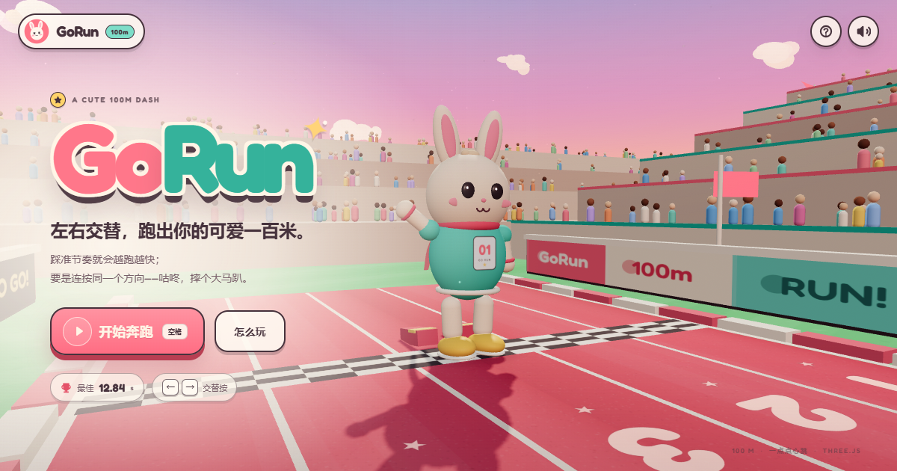
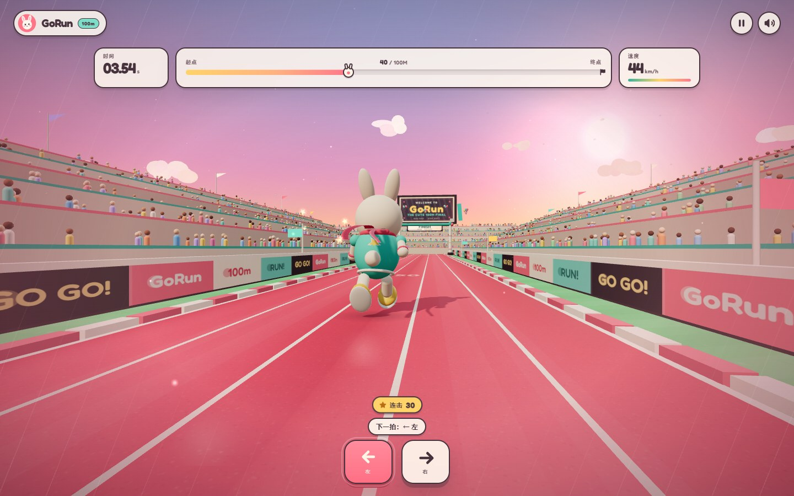
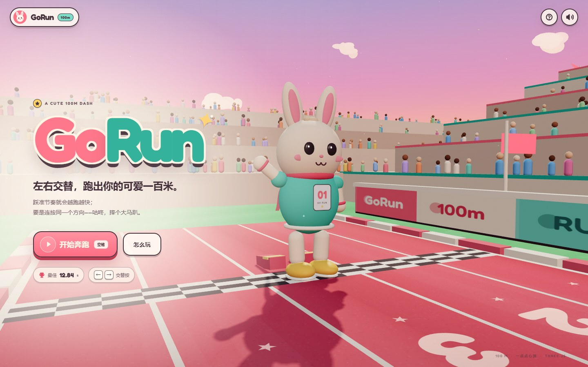
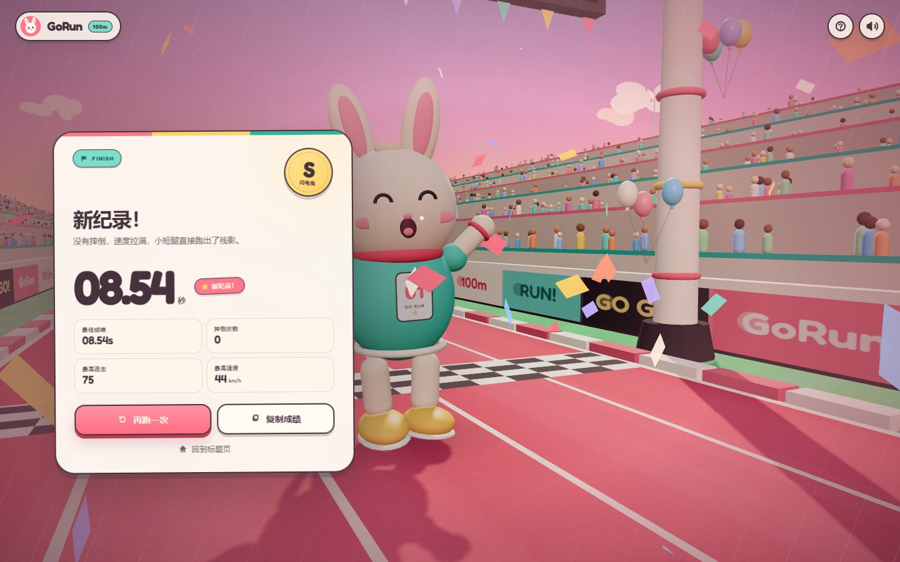
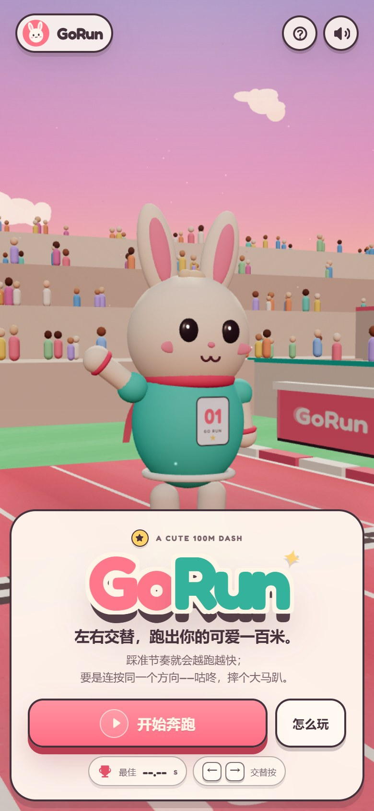

<div align="center">



# GoRun

**左右交替，跑出你的可爱一百米。**

[**在线试玩 GoRun →**](https://keyzhao0118.github.io/GoRun/)

一个可以真的跑起来的 3D 小游戏：交替按 <kbd>←</kbd> <kbd>→</kbd>，节奏越快，小兔越快；
但要是不小心连按同一个方向——咕咚，摔个大马趴。

[玩法](#玩法) · [本地运行](#本地运行) · [部署到-github-pages](#部署到-github-pages) · [技术细节](#技术细节)

</div>

---

## 这游戏是什么？

GoRun 是一个固定 100 米的 3D 跑步小游戏。没有关卡，没有氪金，只有一条可爱的粉色跑道、
一个努力倒腾小短腿的兔子，以及你的手速。

- 在低机位 3D 体育场里，从起跑线一路冲过 100 米终点
- 左右键交替迈步，按键节奏会直接变成速度
- 连按同一个方向会绊倒，需要等小兔晕乎乎地爬起来
- 有计时、最高速度、连击、评级、本地最佳纪录和分享按钮
- 所有画面、角色、音效和纹理均由代码实时生成，不依赖外部素材



## 玩法

| 操作 | 说明 |
| --- | --- |
| <kbd>←</kbd> / <kbd>→</kbd> 或 <kbd>A</kbd> / <kbd>D</kbd> | 左右交替迈步；**按得越快，速度越快** |
| 连续按同一个方向 | 绊倒！等 1.5 秒左右爬起来，期间不能加速 |
| <kbd>空格</kbd> / <kbd>Enter</kbd> | 开始奔跑 / 在结算页再来一次 |
| <kbd>P</kbd> / <kbd>Esc</kbd> | 暂停 / 继续 |
| <kbd>M</kbd> | 静音 / 打开声音 |
| <kbd>R</kbd> | 结算页再来一次 |

手机和平板可以直接点按屏幕底部的两个大按键，左右交替即可。

> 小提示：不要一上来就疯狂乱敲。先找到稳定的左右节奏，再一点点加速，会比手忙脚乱更快。

## 特性

- **低机位 3D 体育场**：粉红跑道、白色赛道线、大号地贴、阶梯看台、彩色观众、终点大屏和彩带。
- **程序化可爱角色**：奶油色小兔、薄荷色跑步服、珊瑚色围巾、会飘起来的围巾和会抖动的耳朵。
- **实时 3D 动画**：跑步周期、起步、绊倒、爬起、终点庆祝各有自己的动作。
- **速度反馈**：视野随速度变宽、镜头轻震、尾部速度线和脚步尘土会让 44 km/h 跑出感觉。
- **可爱的声音**：Web Audio 合成的脚步音、倒计时、摔倒音、完赛小号角和轻快背景音乐，全部可一键静音。
- **完整一局体验**：倒计时、计时、进度、速度、连击、暂停、结算、评级、本地最佳成绩、复制成绩。
- **移动端适配**：底部大按键、安全区、竖屏菜单、横屏结算都做了单独布局。
- **零构建**：原生 HTML/CSS/ES Modules，Three.js 与字体都已经本地化，直接静态托管即可。

## 本地运行

需要 Node.js 18+（仅用于起一个本地静态服务器，游戏本身没有构建步骤）：

```bash
npm start
```

然后打开终端里提示的地址（默认是 <http://127.0.0.1:4173>）。

也可以使用任意静态文件服务器，例如：

```bash
npx serve .
# 或
python -m http.server 4173
```

> 不建议直接双击 `index.html`：ES Modules 和 Import Map 需要通过 HTTP 加载。

## 部署到 GitHub Pages

这是一个纯静态站点，有两种部署方式。仓库里已经带好了 **GitHub Actions** 工作流。

### 方式一：GitHub Actions（推荐）

1. 把仓库推送到 GitHub。
2. 打开仓库的 **Settings → Pages**。
3. 在 **Build and deployment → Source** 中选择 **GitHub Actions**。
4. 推送到 `main` 分支（或手动触发一次 **Deploy GoRun to GitHub Pages** 工作流）。
5. 等 Actions 跑完，页面地址会显示在该 workflow 的部署步骤里，通常形如：
   `https://<你的用户名>.github.io/GoRun/`

工作流文件：[.github/workflows/deploy.yml](./.github/workflows/deploy.yml)。它只会把
`index.html`、样式、`src/`、`vendor/` 和 `assets/` 复制到 Pages 产物里，不会上传开发用的临时文件。

### 方式二：从分支直接部署

如果不想用 Actions：

1. **Settings → Pages → Source** 选择 **Deploy from a branch**。
2. 选择 `main` 分支和 `/(root)` 目录。
3. 保存即可。仓库根目录带有 `.nojekyll`，不会经过 Jekyll 处理。

### 分享图

项目的 Open Graph / Twitter 分享图已经指向当前 Pages 地址：

```html
<meta property="og:image" content="https://keyzhao0118.github.io/GoRun/assets/og-cover.png" />
```

如果你 fork 到自己的账号或修改了仓库名，记得同步修改 `index.html` 里的
`og:url`、`og:image`、`twitter:image` 和 `canonical`。

## 截图

<div align="center">
  
  
</div>

<div align="center">
  
</div>

## 项目结构

```
.
├── index.html               # 页面、UI 结构、Import Map
├── styles.css               # 完整界面样式与响应式布局
├── favicon.svg
├── src/
│   ├── main.js              # 状态机、输入、相机、HUD、计时与存档
│   ├── world.js             # Three.js 场景：体育场、跑道、看台、天空、终点
│   ├── character.js         # 小兔模型 + 跑步/摔倒/庆祝的程序化动画
│   ├── fx.js                # 尘土、星星、彩带
│   ├── audio.js             # Web Audio 合成音效与 BGM
│   └── utils.js             # 数学与 Canvas 纹理工具
├── vendor/
│   ├── three.module.js      # Three.js r170
│   └── LICENSE-three.txt
├── assets/
│   ├── fonts/               # Fredoka（含 OFL 许可证）
│   ├── og-cover.png
│   └── screenshot-*.jpg
├── scripts/serve.mjs        # 零依赖本地静态服务器
└── .github/workflows/deploy.yml
```

## 技术细节

- **无构建**：浏览器原生 ES Modules + Import Map。Three.js 和 Fredoka 字体都已放在仓库内，访问时不需要第三方 CDN。
- **程序化资产**：跑道、地贴、观众、彩带、标语、UI 图形均由 Canvas 2D 或 Three.js 几何体生成；没有下载任何 3D 模型或贴图。
- **性能**：观众和云朵使用 `InstancedMesh`；阴影贴图在触摸设备上自动降低；桌面和移动端分别锁定渲染像素比。
- **存档**：最佳成绩和静音状态保存在浏览器 `localStorage`，不上传服务器。
- **兼容性**：建议使用最新版 Chrome、Edge、Safari 或 Firefox。需要支持 WebGL2、ES Modules 和 Import Maps。

## Credits

- [Three.js](https://threejs.org/) r170 — MIT License，许可证见 [vendor/LICENSE-three.txt](./vendor/LICENSE-three.txt)。
- [Fredoka](https://fonts.google.com/specimen/Fredoka) — SIL Open Font License 1.1，许可证见 [assets/fonts/OFL.txt](./assets/fonts/OFL.txt)。
- 玩法与镜头语言受到 Luke Doukakis 的 *Speed Stars* 启发；本项目的代码、角色、场景与音效均为原创实现，没有使用该游戏的素材。

<div align="center">

**Made with a small pair of running shoes and Three.js.**

</div>
